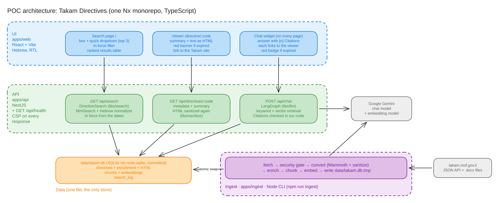

# How to run

The quick start for running the POC on a new machine. The README ("Install and run") has the full details.

## What you need
- **Node.js 24 or newer**. The store uses Node's built-in `node:sqlite`. Check with `node -v`.
- **git** and **npm** (npm comes with Node).

Nothing else: no database server and no Docker.

## 1. Get the code and install
```bash
git clone https://github.com/sternyishai/takam-directives-poc.git
cd takam-directives-poc
npm ci
```

## 2. Run it
```bash
npm run dev
```
Then open **http://localhost:4200**.

The database is already in the repo (`data/takam.db`, a SQLite file). It holds the 30 Directives, their summaries, the chat passages and their embeddings. So search and the Directive viewer work right away, with no key and no ingest run.

## See the diagrams and videos of the prototype
With `npm run dev` running, the navbar at the top of every page has four pages:
- **האפליקציה** (http://localhost:4200/): the app itself: search, the Directive viewer and the chatbot.
- **תרשימים** (http://localhost:4200/diagrams): the diagrams: the POC architecture, the search, chat and ingest flows, and the production architecture.
- **סרטונים** (http://localhost:4200/videos): two short videos of the prototype: finding, reading and asking about a Directive, and how it works inside.
- **החלטות (ADR)** (http://localhost:4200/adr): the design decisions, in Hebrew.

Without running anything, the same files are in the repo: the diagrams in [docs/diagrams/](docs/diagrams/) (`.png`) and the videos in [docs/videos/](docs/videos/) (`.mp4`). To add a video, put its `.mp4` file in `docs/videos/`.

## How it fits together
`npm run dev` starts two processes:
- **The web app** (React, port 4200): the search page, the Directive viewer and the chat window. It sends every `/api/...` request to the API.
- **The API** (NestJS, port 3456): when it starts, it reads `data/takam.db` and builds the search index in memory. It answers search, viewer and chat requests. Only chat calls out to Gemini.



More diagrams are in [docs/diagrams/](docs/diagrams/), for example the [chat flow](docs/diagrams/chat-flow.png).


## 3. Turn on the chatbot (optional)
The chatbot needs a Gemini API key. If you were sent one:
```bash
cp .env.example .env
```
Open `.env`, put the key after `GOOGLE_API_KEY=`, and restart `npm run dev`.

Without a key, the chat window says chat is unavailable, and everything else keeps working.
Don't commit `.env`: it is gitignored.

## Check that it works
- `curl http://localhost:3456/api/health` returns `{"directives":30,...}`.
- Search for `נסיעות` on the home page.
- Open http://localhost:4200/directive/H.13.10.1.
- With a key, ask the chatbot `מה התעריף לקצובת הבראה?`.
- `npm test` runs every test. It needs no network and no key.

## If something goes wrong
| Problem | Fix |
|---|---|
| `No such built-in module: node:sqlite` | Your Node is older than 24. Upgrade it. |
| Port 3456 is already in use | `PORT=4000 npm run api` in one terminal and `API_URL=http://localhost:4000 npm run web` in another. |
| Port 4200 is already in use | Nothing to do: Vite picks the next free port and prints it. Open that one. |
| `git status` shows `data/takam.db` as modified | That's normal: every search adds a row to the `search_log` table. `git checkout data/takam.db` undoes it. |
| `npm run typecheck` fails with TS6305 | Run `rm -rf apps/ingest/dist` (left over from a local build). |

## Don't run `npm run ingest`
It downloads the Directives again from the Takam site and rebuilds the database, which needs network access and a key. The committed database already has everything.
