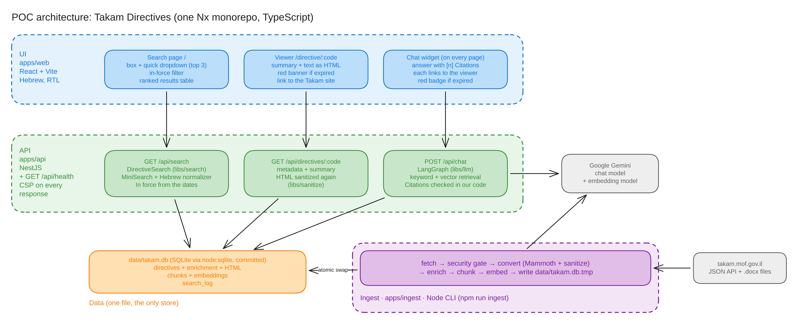

# Takam Directives POC

A take-home assignment built on the Takam Directives website, https://takam.mof.gov.il/. Takam (תכ"ם) holds the Accountant General's binding Directives for government ministries.

- **Part A** (below): the problem, the solution and the technical design.
- **Part B:** how to install, run and test the POC from a clean clone, and the decisions made while building it.
- **Part C:** short answers, with links to the production design in [`docs/production-hld.md`](docs/production-hld.md).

Terms such as Directive, Edition, In force and Citation are defined in [`GLOSSARY.md`](GLOSSARY.md). The decisions with real trade-offs are in [`docs/adr/`](docs/adr/).

## Part A: Problem and solution

### The problem
Government employees in finance, salaries, procurement and HR have to follow the Takam Directives, which are binding. On the current site they can't reliably **find** the Directive that applies to them, can't **read** it without downloading a Word file, and can't **trust** that it is still in force.
Each point below was checked on the live site on 2026-11-23 (all of the evidence is in [`docs/ux-findings.md`](docs/ux-findings.md)):

| | What happens on the site today | Evidence |
|---|---|---|
| Find | Search covers only the metadata (title, code, keywords), never the text. | Headings inside Directive H.1.1.1, such as "תקציב גמיש" (flexible budget), return 0 results. |
| Find | Search matches parts of words, with no ranking. | "רכב" (car) returns 62 results, and the first is H.1.1.1, a budget glossary, because its keywords contain "הרכב התקציב" (the *composition* of the budget). The results are a chapter tree, not a ranked list. |
| Find | There is no tolerance for typos or Hebrew spelling variants. | "גמלאות" (pensions) finds 8, while "גימלאות", the same word in full spelling, finds 0. "רכבב" (one extra letter) finds 0. |
| Find | The metadata is thin, so better matching on it alone can't fix search. | 696 of 1,127 Documents have no keywords, and in 260 of 418 Instructions the description is just the code. |
| Read | Reading a Directive means downloading a `.docx`. | Nothing is shown in the browser. That is awkward on a phone, and a section can't be linked to. |
| Trust | Expired Directives are mixed in with the rest and hardly marked. | The validity filter defaults to "all". 53 Documents have expired. One of them shows a green "valid" check next to its title, and the API's own `isvalid` flag is inverted (ADR 0001). |

**Who it affects:** every ministry employee who has to act by a Directive, such as paying a per-diem abroad or a car allowance, and the Takam staff who answer the questions those employees can't settle on the site.
**Why it is worth solving:** a Directive is a binding rule about public money. When the right one can't be found, someone pays by a rule they remember, by an expired one, or not at all, and someone else has to answer a question the site should have answered.

### The solution
A web app over the same Directives that fixes the three problems:
- **Find:** full-text search over each Directive's own text (its title, code and headings), plus a short summary, keywords and likely questions that an LLM writes for each Directive. Matching is by whole word and understands how Hebrew is typed: prefixes (ה/ב/ל…), full and short spelling, quotes in abbreviations, final letters, niqqud, and a typo scaled to the word's length. The results are one flat ranked list, each with a snippet that shows why it matched. A dropdown shows the top 3 while you type.
- **Read:** each Directive opens as a page in the browser, converted from its Word file and sanitized, with a short summary on top and a link to its page on the official site.
- **Trust:** In force is computed from the validity dates on every request, never from the `isvalid` flag. Search shows only Directives in force unless you ask for the rest, and every expired Directive gets a red badge or banner.
- **Ask** (the optional AI part): a chatbot answers a question only from passages of the Directives, and cites them as `[n]`. Our code checks every Citation before the answer is shown. A Citation links to the Directive, and an expired one is flagged. If the Directives don't answer the question, it says so.

The POC covers 30 Directives (in [`apps/ingest/ingest.config.json`](apps/ingest/ingest.config.json)), chosen to test the hard cases: the "רכב" trap, the two spellings of "גמלאות", similar travel Directives, two expired ones, one that starts in 2027, and the common allowance questions.

### The technical design


Source: [`docs/diagrams/poc-architecture.excalidraw`](docs/diagrams/poc-architecture.excalidraw). Each of the four diagrams in [`docs/diagrams/`](docs/diagrams/) is a PNG with its Excalidraw source beside it, which opens at https://excalidraw.com for editing.

One Nx monorepo, in TypeScript throughout:

| Part | What it does | Technologies |
|---|---|---|
| `apps/ingest` | A command-line run that downloads each Directive's latest Edition through the site's own JSON API, puts it through a security gate, converts it to HTML, has the LLM write its summary, cuts it into chunks and embeds them, and swaps a new store in only if the run is good. [Pipeline diagram](docs/diagrams/ingest-pipeline.png) | Node 24, JSZip, Mammoth, sanitize-html, LangChain |
| `apps/api` | `GET /api/search`, `GET /api/directives/:code`, `POST /api/chat` and `GET /api/health`. Builds the search indexes from the store when it starts. | NestJS |
| `apps/web` | The search page (box, dropdown, filter, results table), the viewer, and the chatbot on every page, in Hebrew, right to left | React, Vite, React Router |
| `libs/search` | Hebrew normalization, Directive search and passage search, cosine similarity | MiniSearch |
| `libs/llm` | The models (Gemini, and fakes for the tests), enrichment, and the chat as a LangGraph: retrieve → generate → checkCitations, with one retry. [Chat-flow diagram](docs/diagrams/chat-flow.png) | LangChain.js, LangGraph, zod, Gemini |
| `libs/store`, `libs/sanitize`, `libs/shared` | The SQLite schema and queries, the HTML allowlist, and the types and date rules both sides share | `node:sqlite`, sanitize-html |
| `data/takam.db` | The only store: Directives, enrichment, HTML, chunks with their vectors, and the search log. It is committed, so search, the viewer and the tests need no network and no key (ADR 0003). | SQLite |

Why these choices:
- **TypeScript in every part,** so the API and the web app share types, and one test runner style covers everything.
- **The site's JSON API, not scraping its pages:** the same endpoints the site's Angular app uses (see [`docs/site-research.md`](docs/site-research.md)).
- **One SQLite file and an in-memory index:** 30 Directives and 376 chunks need no database server and no vector database. Production moves to Postgres with pgvector ([HLD, Runtime](docs/production-hld.md#1-runtime)).
- **LangChain models as the seam to the LLM** (ADR 0002): Gemini is one class, and the tests use LangChain's fake models, so no test needs a key. The Citations are checked by our code, so changing the vendor does not change how safe the answers are.

How it would run in an organization is in the [production HLD](docs/production-hld.md) and its [diagram](docs/diagrams/production-architecture.png).

## Part B: POC

### Install and run
You need Node.js 24 or newer (the store uses Node's built-in `node:sqlite`), npm and git. From a clean clone:

```bash
git clone https://github.com/sternyishai/takam-directives-poc.git
cd takam-directives-poc
npm ci                  # installs exactly what package-lock.json lists
npm test                # every test; needs no network and no key
```

The committed store (`data/takam.db`) already holds the 30 Directives, so everything except the chatbot works with no configuration. To run the app:

```bash
cp .env.example .env    # then put your Gemini key in GOOGLE_API_KEY (search works without it)
npm run dev             # the API on http://localhost:3456/api and the web app on http://localhost:4200
```

Open http://localhost:4200. The page shows how many directives are in the store.
With an empty store it says "במאגר 0 הוראות". You can also run one side only:

| Command | What it does |
|---|---|
| `npm run web` | the web app (Vite dev server, port 4200; `/api` is proxied to port 3456) |
| `npm run api` | the NestJS API (port 3456, or `PORT`) |
| `npm run ingest` | downloads, checks, converts, chunks and enriches the 30 Directives in `apps/ingest/ingest.config.json` into a new store (needs `GOOGLE_API_KEY`) |
| `npm run export` | writes each Directive in the store, enrichment included, to `data/export/<code>.json`, to read without SQLite |
| `npm run lint` | ESLint on every project |
| `npm run format:check` | Prettier: fails if any code file is not formatted (`npm run format` fixes them) |
| `npm run typecheck` | TypeScript on every project |
| `npm test` | every test project (Vitest for the libs, web and ingest; Jest for the API) |
| `npm run build` | builds every project |

`curl http://localhost:3456/api/health` returns `{"directives":30,"indexSize":30,"lastIngest":"…"}` against the committed store.
The API opens `data/takam.db` (set `DB_PATH` to use another file). If the file does not exist, the API creates it with an empty schema.
If the API runs on another port (`PORT=4000 npm run api`), start the web app with `API_URL=http://localhost:4000 npm run web` so its `/api` proxy finds it.

### Search
```bash
npm run dev
```
Open http://localhost:4200. Before any search, the table lists every In-force Directive in code order. Type a word or a Document code (`נסיעות`, `13.10.1`) and press "חיפוש" (search): the table then shows only the results, best match first, and "הצג את כל ההוראות" (show all the Directives) brings the full list back. The table scrolls in its own box, with its header row always in view. Each row shows:
- the Document code
- the title, linked to the viewer, with a snippet under it (the heading that matched, or else the Directive's summary)
- its subject (its closest Chapter, e.g. `13.4 נסיעות בתפקיד בארץ`)
- its Directive type
- a green "בתוקף" (in force) or red "לא בתוקף" (not in force) badge

Only In-force Directives are shown until you tick "הצג גם הוראות שאינן בתוקף" (show Directives that are not in force too).
The query and the filter are kept in the URL (`/?q=רכב&expired=1`), so the viewer's back link, the browser's back button and a shared link all show the same results.

While you type, a dropdown under the box shows the top 3 matches, each with its Document code, title and a green "בתוקף" (in force) or red "לא בתוקף" badge. The arrow keys move the selection, Enter opens the selected Directive, and Escape closes the dropdown. Clicking an entry opens it too. Enter with nothing selected, or the "חיפוש" button, shows the full results.
The API is `GET /api/search?q=…&inForce=true&limit=20`. `inForce` is true unless it is `false`, and `limit` is 1 to 50 (the table asks for 50). An empty `q` returns every Directive, in code order. Every search adds a row to the `search_log` table: the query, the filter, the number of results and the time.

### Ask the chatbot
```bash
npm run dev        # needs GOOGLE_API_KEY and LLM_MODEL in .env
```
On any page, the "שאלו את ההוראות" (ask the Directives) button in the bottom corner opens the chat window. Type a question, or click one of the example questions, for example "מה התעריף לקצובת הבראה?" (what is the recuperation pay rate?). Enter sends, and Shift+Enter starts a new line. The answer cites the passages it used as `[n]`. Under it, each Citation shows its number, the Directive's code and title, and links to the viewer, with a red "לא בתוקף" badge if the Directive is Expired. When the Directives don't answer the question, the bot says "לא מצאתי תשובה בהוראות" (I didn't find an answer in the Directives).
The window keeps the conversation while you move between pages (after opening a Citation, say), until the page is reloaded. Each question is still sent on its own: the API does not see the earlier ones.
Without a key, or when Gemini fails, the bot says chat is unavailable, and search and the viewer keep working.
The API is `POST /api/chat` with `{"question": "…"}` (1 to 500 characters). It returns `{answer, citations: [{n, code, title, inForce}], found}`, 400 without a usable question, and 503 when chat is unavailable.

### Read a Directive
The store (`data/takam.db`) is committed with the 30 Directives in it, so this needs no network:
```bash
npm run dev
```
Then open http://localhost:4200/directive/H.13.10.1. The page shows the Directive's code, title, type, a short summary (marked as written by a language model), its chapter path, edition, validity dates, a link to its page on the Takam site, and its text.
An expired Directive (try `HZ.13.10.1.1`) gets a red "הוראה זו אינה בתוקף" (this Directive is not in force) banner.
"→ חזרה" (back) at the top returns to the page you came from, such as the same search results. After a direct link it says "→ לכל ההוראות" (to all the Directives) and leads to `/`.

### Refill the store
```bash
npm run ingest     # needs network access to the Takam site and GOOGLE_API_KEY in .env
```
Ingest reads the Document codes from `apps/ingest/ingest.config.json` (the 30 in `docs/plan.md`). It finds each one by its Document code (`documentcodetext`), so Temporary Instructions (`HZ.…`) and Messages (`HOD.…`) are found the same way as Instructions.
For each code, ingest does the following:
1. Finds the Document in the site's Document list.
2. Takes its highest Edition and downloads that Edition's Word file.
3. Puts the file through the security gate.
4. Converts it with Mammoth.
5. Enriches it: one Gemini call returns a Hebrew summary, keywords and likely questions (see "Enrichment" below).
6. Splits it into chunks for the chatbot (see "Chat" below).
7. Writes it and its chunks to a new store, `data/takam.db.tmp`.

It prints `✓` or `✗ <reason>` for each code, and a line for each enrichment failure. Then:
- If at most 20% of the files were rejected and at most 20% of the enrichments failed, it records the time of the run and moves the new store over `data/takam.db`.
- Otherwise it deletes the new store, keeps the old one, and exits with code 1.
The raw files are kept in `data/raw/`, which is gitignored and never served.
`GET /api/directives/:code` returns the stored Directive, or 404 for an unknown code.

### Layout
| Project | What it is |
|---|---|
| `apps/web` | React + Vite, Hebrew and right-to-left (`<html lang="he" dir="rtl">`) |
| `apps/api` | NestJS: `GET /api/health`, `GET /api/search`, `GET /api/directives/:code` and `POST /api/chat` |
| `apps/ingest` | Node CLI that fills the store: Takam site client, security gate, Mammoth conversion, chunking |
| `libs/search` | `DirectiveSearch`: MiniSearch over the title, Document code, headings and enrichment; `PassageSearch`: MiniSearch over the chunks, for the chatbot. Both share the Hebrew normalization and typo tolerance in `words.ts` |
| `libs/llm` | LangChain chat models (Gemini, and the fake one for tests), enrichment, and the chat LangGraph with its citation check |
| `libs/shared` | types shared by the API and the web app (`HealthReport`, `Directive`, `SearchResult`, `ChatAnswer`, `Citation`, `Passage`), plus `isInForce`, `todayInIsrael` and `officialPageUrl` |
| `libs/store` | the SQLite schema and the `Store` class: ingest writes to it, the API reads from it |

### Decisions made while building
- **Nx with npm workspaces.** Each app and lib is an npm workspace package (`@takam/web`, `@takam/shared` and so on), and Nx infers the `lint`, `test`, `typecheck` and `build` targets from the config files. `nx sync` keeps the TypeScript project references in step.
- **Health is tested over real HTTP.** The API test starts the whole Nest app on a random port with an in-memory SQLite database (`DB_PATH=:memory:`) and calls it with `fetch`, so it checks the route, the module wiring and the schema together.
- **The web test fakes only `fetch`.** The component is rendered for real; only the network call to the API is replaced.
- **The schema is created on startup** with `CREATE TABLE IF NOT EXISTS`, so a missing or empty DB file is never an error. Later milestones add columns and tables.
- **`data/takam.db` is committed** (ADR 0003), so a clean clone runs the viewer and the tests with no network. Each ingest run builds a whole new store, so a schema change only needs a new run.
- **A fourth library, `libs/store`.** Ingest writes the store and the API reads it, so the schema and the SQL live in one place that both import. It is Node-only (`node:sqlite`), which is why it is not in `libs/shared`: the web app imports `libs/shared`. In the API, `StoreService` is just `Store` made into a Nest provider.
- **In force is computed by the API on each request**, from the dates and today's date in Israel (ADR 0001). The store keeps only the dates, so a Directive turns expired at midnight without a new ingest. `isInForce` compares ISO date strings, which sort the same way as dates. Both ends are inclusive, and a missing valid-to means no end.
- **The security gate checks the cheapest things first:**
  1. the size (under 2 MB)
  2. the zip magic bytes `PK\x03\x04`, with a separate reason when the file is the site's HTML page
  3. that the zip opens and contains `word/document.xml`
  4. that it is not a zip bomb: fewer than 200 entries (the real files have about 30) and under 20 MB once expanded

  For the expanded size, the gate does not trust the sizes the zip states for its entries, because a zip bomb can lie there. It expands every entry as a stream and counts the bytes, stopping at 20 MB, so a bomb never fills the memory.
- **Ingest builds a new store and swaps it in.** It writes to `data/takam.db.tmp` and, only if at most 20% of the files were rejected, renames it to `data/takam.db`. A rename within one folder is atomic, so the API never opens a half-written file, and a failed run (say the site's firewall answers every download with its HTML page) leaves the previous store in place. A few rejected files are logged but don't fail the run: one changed Directive shouldn't block the other 29. An API that is already running keeps reading the old file until it restarts.
- **`runIngest` takes the site as a parameter.** `main.ts` passes the real site client (`takam-site.ts`), and the tests pass a fake one that serves tiny Word files or the site's HTML page. That way the 20% rule and the swap are tested without the network.
- **The validity dates come from the Edition ingest converts** (`rtn_validfrom__c` / `rtn_validto__c`), not from the Document list. The text and the dates then always belong to the same Edition. For the latest Edition the two sources hold the same dates. All 1,247 dates on the site are UTC midnight (`…T00:00:00.000Z`), so ingest keeps the first 10 characters as the ISO date.
- **The download URL ends with the Document code** (`…/DownloadDocument/{contentVersionId}/{code}`). The last segment is only a file name, but an empty one makes the site answer with its HTML page.
- **Ingest names itself in the User-Agent header** (`takam-poc-ingest/0.1`). The site's firewall (Sucuri) answers 403 to Node's default User-Agent, `node`.
- **Messages without Chapters use their parent's.** 140 of the site's 547 Directives (mostly `HOD.…` Messages) have no Chapter fields, only a `parentdocument`. Ingest walks up to the parent to build the chapter path.
- **Images are dropped.** Mammoth is given an image converter that writes an empty `src` instead of embedding the picture, and the sanitizer then removes the `` tags. The text is what matters, and images would bloat the store.
- **The heading style map was built from the real files, not from the plan's guess.** The plan expected `כותרת רמה 1` in the custom-style Directives. The actual Word files use:
  - the Instructions (H.13.10.1, HZ.13.10.1.1): Word's standard `heading 1`, plus a custom `נספח - כותרת` for appendix titles
  - H.1.1.1: custom numbered styles `כות_1`, `כות_1.1` and `כות_1.1.1`. Without a mapping, Mammoth shows these as list items, because Word numbers them like a list.

  Every top-level heading becomes `h2`, because the page's own `h1` is the Directive's title, and the levels below move down one. Word's table of contents (`toc 1-3`, `תוכן_עניינים`) is dropped: its page numbers mean nothing on the web. A mapping is only added for a style seen in a real file. After the full subset was ingested, the other 28 files were checked for styles Mammoth doesn't know. None of them is a heading: they are numbered clauses (`סעיף רמה 2`…`6`, `תת סעיף`), definitions (`הגדרות`), appendix descriptions (`נספח - תיאור`) and table captions (`כותרת טבלת נספחים`). Mammoth shows them as plain paragraphs, which is right, so no mapping was added.
- **The HTML is sanitized twice: by ingest before it is stored, and by the API before it is sent.** The sanitizer (`libs/sanitize`, with sanitize-html) is an allowlist: `h2`–`h4`, `p`, `br`, lists, tables (with `colspan`/`rowspan`), `strong`, `em` and `a`. Nothing else survives, including `style` and every `on…` attribute. A removed tag keeps its text, except `<script>` and `<style>`, which go with their content. Only links to `http(s)` addresses stay links. Any other link (a `javascript:` link, or a footnote link like `#footnote-1`, which can't work once the ids are removed) is reduced to its text.
  - Those other links are removed with `exclusiveFilter` returning `'excludeTag'` (drop the tag, keep the text). They used to be renamed to `<span>` in `transformTags` and then dropped, but sanitize-html 2.18 then closes the next element with `</span>` (e.g. `<h2>נספח א</span>`). That broke the nesting in 28 of the 30 stored Directives, mostly after Word's empty bookmark links (`<a id="…"></a>`). The store was re-ingested after the fix, and only the tags changed: the text of all 30 is the same.
  - Why twice: the viewer inserts the HTML with `dangerouslySetInnerHTML`, so the API must never send unsafe HTML, even from a store that was filled before the sanitizer existed or was edited by hand. Cleaning in ingest keeps the stored HTML (and the chunks built from it later) clean, and cleaning in the API is the last check before the browser. The cost is a few milliseconds per request.
  - It is a library, not a file in ingest, because both apps call it.
  - sanitize-html's HTML parser (htmlparser2) ships only as an ES module. Node 24 loads it fine, but Jest can't, so `apps/api/jest.config.cts` tells Jest to transform those packages (`transformIgnorePatterns`).
- **The API sends `Content-Security-Policy: default-src 'none'; frame-ancestors 'none'` on every response**, errors included. The API only sends JSON, so it may load nothing, and no site may frame it. The header is set in `configureApp` (`apps/api/src/app/configure-app.ts`), which `main.ts` and the e2e tests share, so the tests run the same setup as the real server. The page's own CSP belongs to whatever serves the built web app (see the production HLD).
- **The official link is `https://takam.mof.gov.il/document/{code}`.** This is the site's own Angular route, `document/:id`, which loads a Document by its code.
- **The router (`BrowserRouter`) wraps `App` in `main.tsx`**, so the tests can render `App` inside a `MemoryRouter` at any URL.
- **Search matches whole words only.** MiniSearch is used without prefix matching, so "רכב" (car) does not match the inside of a longer word, and "נסיע" finds nothing. Words are split at spaces and punctuation, but a dot or a quote inside a word is kept, so `13.10.1` and `צה"ל` each stay one word.
- **Every word is normalized the same way in the index and in the query** (`normalizeWord` in `libs/search`), so the ways Hebrew is really typed all match. In this order:
  1. lower case
  2. niqqud (vowel points) removed: `רֶכֶב` → `רכב`. The regular expression `\p{Mn}` matches every mark that sits on a letter.
  3. quotes removed: `אש״ל` (gershayim), `אש"ל` (ASCII quote) and `אשל` all become `אשל`. The plan said to turn ״ into `"`; removing all quotes does that and also matches the abbreviation typed with no quote, which is how many people type on a phone.
  4. one Hebrew prefix letter (ה ב ל ו מ ש כ) stripped if at least 2 letters remain: `ברכב`, `הרכב` and `לרכב` become `רכב`. Only one, so `והרכב` (and the car) stays `הרכב`.
  5. ו and י removed: `גימלאות` (full spelling) and `גמלאות` (short spelling) both become `גמלאת`. This comes after the prefix step on purpose. Removing ו/י first made a leading י expose the next letter as a "prefix", so `ישראל` became `ראל` and `ישיבת` (meeting of) matched `בת` (daughter).
  - The cost: different words can become the same form. `ביטוח` (insurance) and `בטוח` (safe) both become `טח`, and the trap `הרכב התקציב` (the composition of the budget) now matches "רכב". The title weight keeps the real car Directives above it.
- **Typos are tolerated, scaled to the word's length** (`typosAllowed`): no typo up to 3 letters, one from 4 letters, and at most two, from 8, counted after normalization. The cost: a 4-letter word one letter longer than a real word matches it, so `רכבת` (train) finds `רכב` (car), below the exact matches. Short Hebrew words are often one letter apart (`רכב` car, `רכז` coordinator), so they must match exactly. A word with a digit (a Document code or a number) is always matched exactly, so `13.10.1` never finds `13.10.2`. A typo match counts 0.2 of an exact one (MiniSearch's default is 0.45). With 0.45, "תשלום" ranked a Directive whose title has "תשלומים" (one edit away) above the one with "תשלום" in a heading.
- **Document codes are indexed as two words:** the whole code and the code without its letters (`H.13.10.1` → `h.13.10.1`, `13.10.1`). Typing `13.10.1` finds `H.13.10.1` and not `HZ.13.10.1.1`, because a code is matched as a whole.
- **Field weights:** a word in the title or the code counts three times as much as a word in a heading. The title says what a Directive is about, while a heading can mention a word in passing. The enrichment counts less than a heading: keywords 0.7, summary and questions 0.5 each (see "Enrichment").
- **Validity first.** The filter defaults to In force. When expired Directives are included, every In-force result still comes before every expired one, so an old rule never ranks above a current one. A Directive whose valid-from date is still to come (HOD.13.4.1.2 starts on 2027-01-01) is not In force either, so it gets the same red badge.
- **`search()` takes today's date as an argument** (`{ today }`) instead of reading the clock, so the tests can check the inclusive valid-to boundary on any day. The API passes `todayInIsrael()`, which moved from the directives controller to `libs/shared` so both controllers use it.
- **The snippet is the first heading that contains a matched word**, or else the Directive's summary. The first 200 characters of the text are used only when enrichment failed. The opening of a Directive is often boilerplate ("על פי פקודת…"), while the summary says what the Directive is about.
- **The API builds the index from the store once, when it starts** (`SearchService`). It pulls the heading text out of the sanitized HTML with a regular expression. That is safe here because the sanitizer leaves only bare tags such as `<h2>`. A heading stops at its closing tag or at the next block tag, as a guard against a heading that is never closed (as H.13.12.1's was before issue #20). `indexSize` in `/api/health` is the number of Directives in the index.
- **The search log lives in the store**, as the plan says, so running the API against `data/takam.db` adds rows to the committed file. Run it with `DB_PATH` pointing at a copy if you don't want that. Each ingest builds a new store, so ingest also clears the log.
- **The quick-search dropdown is hand-written, with no combobox library.** It calls the same endpoint as the full results, with the same filter and `limit=3`. The API cuts one ranking to the limit, so the dropdown always shows the first 3 of the full results, in the same order. On the real data, "נסיעות" gives H.13.10.3, H.13.10.1 and H.13.10.2 in both.
  - It searches 150 ms after typing stops. Each keystroke restarts a `setTimeout` in a `useEffect`, and the effect's cleanup clears the previous one, so a fast typist sends one request, not one per letter. A late answer to an older query is ignored, as in the full results.
  - Typing opens it, and Escape or a submit closes it. Escape calls `preventDefault`, because in a `type="search"` box the browser would also empty the box.
  - The selected entry is an index (`-1` for none) kept in state. Enter on a selected entry calls `navigate` and `preventDefault`, so the form is not submitted. With nothing selected, Enter is left to the form.
  - It does not close when the box loses focus. Closing on blur hides the entry before a click on it lands (blur comes first), and the plan leaves full dropdown accessibility out of scope.
  - If the dropdown's request fails, it stays empty: it is only a shortcut, and the full results report the error.
  - The matches are kept with the query they are for, and shown only while that query is still in the box. Without that, the previous text's matches would stay on screen until the new ones arrive, and ArrowDown + Enter could open a Directive that doesn't match what is typed.
  - The cost: every pause in typing is a search, so the dropdown's requests are in `search_log` too, with partial words such as "נסיע". They can be told apart only by their timing.
- **The results list changes only when a search is submitted.** Typing in the box only updates the dropdown, not the list. Ticking the filter re-runs the last submitted query, not the text now in the box.
- **On the real data, "רכב" now finds H.13.4.1 ("ברכב פרטי") first.** Before prefixes were stripped it found nothing: the only Directive with the word on its own (HOD.13.4.1.2) is not in force until 2027. The trap H.1.1.1 comes second, below the title match.
- **Enrichment** (`libs/llm`, issue #9). Ingest makes one Gemini call per Directive. The call returns `{ summary, keywords[], questions[] }` in Hebrew and goes through LangChain's `withStructuredOutput` with a zod schema (ADR 0002).
  - **Every reply is checked against the zod schema in our code**, not only by the model's own parser. The schema requires a non-empty summary, 1–15 keywords and 1–10 questions, each with at least one Hebrew letter. LangChain's fake model in the tests does not check its replies, and a `refine` (the Hebrew check) is never sent to the model, so only zod can run it.
  - **One retry.** A reply that does not match, or a call that throws (a network error, or a reply that is not JSON), is tried once more. If the second try also fails, the Directive is still stored, with `enrichment_error` set and no enrichment: it can still be found by its title, code and headings, and read.
  - **Enrichment failures have their own 20% rule.** A failed enrichment is not a rejected file, but if more than 20% of them fail, the LLM is down or the key has run out, and the new store would be worse than the old one. Then ingest keeps the old store and exits with code 1, as it does for rejected files. One or two failures are logged and the run goes on.
  - **The model gets the code, the title and up to 20,000 characters of the plain text** (the HTML with its tags removed by `htmlToText`, which moved from the API to `libs/sanitize` so ingest can use it too). Most Directives are shorter. For the longest ones, the opening already says what they are about, and the limit keeps their cost close to the rest. The instructions and the field descriptions are in Hebrew, so the model answers in Hebrew.
  - **temperature 0**, so a re-run gives (nearly) the same enrichment.
  - **The model names were checked against the key** on 2026-11-24: `gemini-3.6-flash` answers `generateContent` and `gemini-embedding-001` answers `embedContent` (3,072 dimensions), so `.env.example` keeps them. One real call takes about 8 seconds, and the full run of 30 enriched all 30 with no failures.
  - **The enrichment is stored as columns of `directives`** (`summary`, `keywords`, `questions` as JSON, `enrichment_error`), and `Store` returns them as one `enrichment` object or `null`. That way a Directive has all three parts or none.
  - **The API sends only the summary** (`summary` in `GET /api/directives/:code`, `null` when enrichment failed). The keywords and questions are only for search.
  - **The viewer shows the summary at the top**, under the title, in a box labelled "תקציר" (summary) with the note "נכתב על ידי מודל שפה. הנוסח המחייב הוא נוסח ההוראה." (written by a language model; the Directive's own wording is what binds). There is no box when enrichment failed.
  - **The plan put keywords above headings in the weights; this issue put all of the enrichment below them.** We follow the issue: the headings are the Directive's own text, while the enrichment is the model's reading of it.
  - **What it fixed on the real data:** neither Expired Directive has keywords on the site. Now `עלויות` (costs) finds HZ.13.10.1.1 and `ייעודיות` (dedicated) finds HOD.13.5.1.1. Each word is only in the Directive's summary, not in its title, text, keywords or questions. `apps/api/src/search/committed-store.spec.ts` checks this on the committed store, and also checks that the word stops finding the Directive once its summary is removed. Finding the words took a test, not a text search: a word can look absent but still match after normalization or as a typo (`להתקנה` did).
  - **Enrichment is tested where ingest uses it**, with the fake model, which is the seam issue #9 named. A second set of tests on `libs/llm` would test the same behaviour twice. (The chat, below, is tested in `libs/llm`, because that is its seam.)
  - **`data/export/` holds one JSON file per Directive** (`npm run export`), with every stored field and the HTML last, so the enrichment can be shown without opening SQLite. The files are a committed copy for people to read; the app reads only `data/takam.db`. Run the export again after each ingest.
  - **`.env` is read by ingest with Node's own `process.loadEnvFile`**, so there is no dotenv dependency. A variable already set in the shell wins.
- **Chat** (issue #10). A question goes through a LangGraph of three steps (`libs/llm/src/lib/chat.ts`, ADR 0002): **retrieve** → **generate** → **checkCitations**.
  - **Chunks are made at ingest** (`apps/ingest/src/chunk.ts`) from the sanitized HTML and stored in a `chunks` table. The HTML is cut before every heading, paragraph, list item and table row. Each piece's text is one paragraph, and a heading (`h2`–`h4`) starts a new section. A section that fits in about 1,200 characters is one chunk. A longer one is cut between paragraphs, never inside one, and each chunk after the first starts with the last paragraph of the one before (one paragraph of overlap), so a clause that leans on the one before it still has it. Sections that are not split share nothing. The overlap is left out when it would push the chunk past the limit, and a paragraph longer than the limit is a chunk of its own. On the real data, the 30 Directives give 376 chunks, with a median of about 1,000 characters and none over 1,300.
  - **Each chunk starts with a context line**, `code · title › section` (just `code · title` before the first heading). A passage then makes sense on its own to the model, and retrieval also matches the Directive's title and the section's heading.
  - **Retrieval started as keyword search only** (`PassageSearch` in `libs/search`): MiniSearch over the chunks, with the same Hebrew normalization and typo rules as the Directive search, cut to the top 5 passages. Issue #11 made it hybrid (see "Hybrid retrieval" below). Expired Directives are included, because the chatbot flags their Citations instead of hiding them.
  - **The model may answer only from the numbered passages**, and must cite them as `[n]`. The instructions are in Hebrew and ask for plain text, because the panel shows the answer as text (the first real answers came with Markdown `**`). temperature 0, as for enrichment.
  - **Our code checks every Citation, not the model.** Every `[n]` must be one of the passages given, and at least one must be cited. `[1, 3]` is read as two Citations, so a bad number inside a list is caught too. On a failure, generate runs once more with its first answer and the reason it was rejected. If that fails too, the answer is "לא מצאתי תשובה בהוראות" with `found: false`. When the model itself says it found no answer, there is no retry, and the answer is `found: false` even if it also cites a passage. When retrieval finds nothing, the model is not called.
  - **A Citation is `{n, code, title, inForce}`**, one per passage cited, in number order. `inForce` is computed on the day of the question, like everywhere else (ADR 0001), and the panel puts the red badge on an Expired one.
  - **The chat model is a Nest provider** (`CHAT_MODEL`). It is Gemini, or `null` when `GOOGLE_API_KEY` or `LLM_MODEL` is missing; then the API still starts, logs that the chatbot is off, and `POST /api/chat` answers 503. A model that throws (quota, network) also gives 503, and the reason is only logged. The tests replace the provider with the fake model. The API now reads `.env` with `process.loadEnvFile`, as ingest does.
  - **The passage search is built once, when the API starts**, from the store's chunks and their Directives' titles and dates, like the Directive search.
  - **Final letters are normalized** (`ך ם ן ף ץ` → `כ מ נ פ צ`) in `normalizeWord`, for both searches. Without it, "התעריף" (the rate) matched "תעריפי" (rates of) only as a typo, at 0.2 weight, and the question "מה התעריף לקצובת הבראה?" did not retrieve HOD.13.3.1.1, the Directive with the rates.
  - **The committed store got its chunks without a new ingest.** Chunks depend only on the stored HTML, so they were written by running `chunkDirective` over the 30 stored Directives. A full ingest would also have called the LLM again and changed the enrichment.
  - **Checked on the real data:** "מה התעריף לקצובת הבראה?" retrieves only H.13.3.1 and HOD.13.3.1.1 (`apps/api/src/chat/committed-store.spec.ts`), and with the real key Gemini answers 511.6 ₪ a day for 2026, citing HOD.13.3.1.1, whose link opens that Directive in the viewer. One question takes about 6 seconds.
  - **No streaming and no history**, as the plan says: one question, one answer. The panel notes that the answer was written by a language model and that the Directive's wording is what binds.
- **Hybrid retrieval** (issue #11). A question worded differently from the Directive ("how much do I get a day on a work trip abroad?" against "קצובת שהייה") shares no words with it, so keyword search alone misses it. Now the chatbot also looks for the chunks whose meaning is closest.
  - **Ingest embeds every chunk** with Gemini's `gemini-embedding-001` (`EMBEDDING_MODEL`), one batch call per Directive, and stores the vector in a new `embedding` column of `chunks`. The vector is JSON text, like the keywords: it is easy to read back and to explain, and SQLite has no array type. A `BLOB` of 4-byte floats would be about a third of the size; at 376 chunks the committed store is about 5 MB in all, which is fine.
  - **768 numbers per vector, not the default 3,072.** Google recommends 768 as one of the smaller sizes for this model (`outputDimensionality`). It is a quarter of the store, and plenty for 376 chunks.
  - **Chunks and questions are embedded differently**, as Gemini asks: `RETRIEVAL_DOCUMENT` for a chunk at ingest, `RETRIEVAL_QUERY` for the question in the API (`embeddingModelFromEnv('chunk' | 'question')` in `libs/llm`). LangChain's class takes the task type once, when it is made, so there are two instances.
  - **A Directive is rejected if any of its chunks gets no vector**, the same way as a file the gate rejects, so it counts toward the 20% rule. LangChain's Gemini class does not throw when a batch fails: it gives an empty vector for each chunk in it, so ingest checks every vector (and that there is one per chunk). A transient failure is retried by LangChain first.
  - **Cosine similarity is plain TypeScript** (`cosineSimilarity` in `libs/search`), as ADR 0003 says: for 376 chunks, comparing the question with every chunk takes about a quarter of a millisecond (measured), so no vector database is needed. Vectors of different lengths throw, because they come from different models and comparing them would mean nothing.
  - **The merge takes the two lists in turn**: the best keyword hit, the closest chunk, the second keyword hit, the second closest, and so on. A chunk already taken is skipped, so it never appears twice. The chat keeps the first 5. Taking turns gives both methods a share of the five places without comparing a MiniSearch score with a cosine, which are on different scales. When both find the same chunk it is taken once, and the next one takes the freed place. The vector side gives its 5 closest chunks, so with no keyword hit the model still gets 5 passages and says itself when they do not answer.
  - **Search stays keyword-only and needs no key.** Only the chat embeds the question. The embedding model is its own Nest provider (`EMBEDDING_MODEL`): `null` when `GOOGLE_API_KEY` or `EMBEDDING_MODEL` is missing, and then the chat retrieves by words only. An embedding call that throws, or that gives an empty vector, gives a 503, like a failing chat model; the chat does not fall back to words, so a broken key shows.
  - **The committed store got its vectors without a new ingest**, as it got its chunks in issue #10. The issue asked for a re-run, and the code supports one: two full runs were tried, and both stored all 30 Directives with all 376 vectors. But each also rewrote the enrichment. In both runs HOD.13.4.1.2 lost its enrichment, because Gemini listed the insurer "We-Sure" as a keyword and every keyword must have a Hebrew letter (issue #9's rule). The summary-only words the search tests use ("עלויות", "ייעודיות") were also gone. So the old store was kept, the `embedding` column was added to it (`ALTER TABLE`, because `CREATE TABLE IF NOT EXISTS` does not add a column to a table that exists), and its chunks were embedded with the same model and settings ingest uses (`embeddingModelFromEnv('chunk')`, every vector checked). The next full ingest gives the same columns. Whether a Latin brand name should be allowed as a keyword is left for a later issue.
- **The look** (issue #30). Plain CSS in `apps/web/src/styles.css`, with no UI library, so every rule can be read and explained.
  - **The colours, corners and shadows are named once** as CSS custom properties (`--color-primary` and so on) at the top of the file, and every rule uses those names. A deep blue for the header, links and buttons, a thin gold line under the header, white cards on a light grey page, and red kept only for "not in force". It does not copy the official site's branding.
  - **The system font** (`system-ui`): every system's own font has good Hebrew letters, and the API's Content-Security-Policy allows no fonts from other sites.
  - **A header on every page** (`app.tsx`), whose name links back to search. The viewer had no way back before. The home page's heading is now "מציאת הוראה" (find a Directive), so the name is not shown twice.
  - **The chat panel was `position: sticky`** beside the results. Issue #33 replaced it with the chatbot in the corner (below).
  - **The Directive text's numbered lists showed a bullet and a number.** Word's numbering arrives from the converter as `<ul><li><ol>`, a bullet list around the numbered one. The CSS hides the outer bullet with `:has()` instead of changing the stored HTML, so a new ingest is not needed.
  - **Wide rate tables scroll on their own**, inside the text, so the page never scrolls sideways. It was checked at 390px wide.
  - **The keyboard focus ring is gold and 3px**, on every link, button and box, so it is easy to see on both white and blue.
- **A results table, a chatbot on every page, and a back link** (issue #33).
  - **The results are a `<table>`**, not cards: a Directive has a code, a title, a subject, a type and a validity, and a table lines those up so they can be compared down a column. It scrolls inside its own box (`max-height` and `overflow: auto`), and its header row is `position: sticky`, so the column names stay in view. On a narrow screen the table keeps a minimum width and scrolls sideways instead of squeezing its columns.
  - **An empty query lists every Directive** (`DirectiveSearch.search` in `libs/search`), so the home page is never empty. They come in code order, with numbers compared as numbers (13.4 before 13.10), and each has its summary as the snippet. The table asks for `limit=50`, the API's largest, so all 30 show. A store over 50 Directives would need paging.
  - **The query and the filter live in the URL** (`useSearchParams`), not in component state. When the user opens a Directive and comes back, the home page is drawn again from scratch: anything kept only in state would be lost, but the URL is still there. This also makes a search a link that can be shared.
  - **The chatbot is rendered by `App`, outside `<Routes>`**, so it is on every page and React keeps it (and its conversation) when the page changes. Only the window keeps the earlier messages: each question is still sent on its own, so the plan's "no history" holds for the API and the model, and the answers stay checkable one by one.
  - **The back link goes back one step in the history** (`navigate(-1)`) when the user came from inside the app, like the browser's own back button. After a direct link there is nothing inside the app to go back to (React Router gives that first page the key `"default"`), so it becomes a link to `/`.
- **Vitest runs once, not in watch mode** (`testMode: "run"` in `nx.json`), so `npm test` finishes.

### Tests and CI
`npm test` runs every test project:
- **Unit tests (Vitest):**
  - `isInForce` and the other `libs/*` code
  - the ingest security gate
  - the ingest conversion: the heading style map, on tiny Word files built in the test
  - the sanitizer in `libs/sanitize` (`<script>`, `onerror`, `javascript:` links)
  - search (`libs/search`): whole words, the "רכב" trap, code lookup, Hebrew spellings (full/short, prefixes, quotes, niqqud), typos, the in-force default, the inclusive valid-to boundary, a future valid-from, snippets, the limit, an empty query, and the enrichment (both Expired Directives found by a summary word, enrichment ranked below headings)
  - ingest with LangChain's fake chat model: an invalid first reply followed by a valid retry is accepted, two bad replies (one not JSON, one not Hebrew) are stored as an enrichment failure, and more than 20% failures keep the old store
  - ingest with a fake embedding model: each chunk stored with its vector, and a Directive whose chunks get empty vectors rejected
  - ingest's chunks: the context line, a split at each heading, a long section split between paragraphs with one paragraph of overlap (and none between sections), and a paragraph longer than the limit kept whole
  - the chat (`libs/llm`) with a scripted fake model: valid Citations, an unknown `[n]` that recovers on the retry, an unknown `[n]` twice (and no Citations twice) giving the "no answer" response, an Expired Citation flagged, at most 5 passages, and no model call when nothing is retrieved
  - the web pages, rendered for real with only `fetch` faked
- **Integration tests (Jest, `apps/api`):** each one starts the whole Nest app on a random port, on an in-memory or temporary SQLite file, and calls it with `fetch`. They also check the CSP header, that unsafe HTML in the store is sent sanitized, that "רכב" does not put the trap H.1.1.1 first, and that every search writes a row to the search log. `POST /api/chat` is tested with the fake model in place of Gemini: an answer with an Expired Citation flagged, with a fake embedding model a passage that only its vector finds (no word in common) and a passage found both ways given to the model once, "no answer" when no chunk matches and there is no embedding model, 503 with no model (while search still works) and when the model throws, and 400 for a missing, empty or too long question (measured after trimming). The panel's box stops at the same 500 characters, so the panel never gets that 400. Three more tests read a copy of the committed store: both Expired Directives are found by a word only their summary has, the recuperation question retrieves the right two Directives, and "מה הסכום היומי שמשלמים לעובד שנשלח לניו יורק?" (what daily sum is paid to an employee sent to New York?) retrieves the per-diem rates abroad, HOD.13.10.2.2, with its vector and not by words alone. Its vector was recorded once from Gemini and is committed (`apps/api/src/chat/testing/per-diem-question.json`), so the test needs no key.

No test needs the network or an API key.

GitHub Actions (`.github/workflows/ci.yml`) runs on every pull request and on every push to `main`. It installs with `npm ci` on Node 24, then runs these steps in order, and stops at the first one that fails:
1. `npm run format:check`
2. `npm run lint`
3. `npm run typecheck`
4. `npm test`
5. `npm run build`

Run the same commands locally before pushing.
Prettier checks code and config only. The Markdown docs are hand-written and kept as written (`.prettierignore`).

## Part C: Engineering thinking and production readiness

### 1. Engineering decisions and quality

**The main design considerations:**
- **Never trust the input.** The files come from an outside site, and the viewer puts their HTML into the page. So every file goes through a gate (size, zip magic bytes, structure, a zip-bomb check that counts the real expanded bytes), and the HTML is sanitized with an allowlist twice: by ingest, and by the API before it sends it. The API also sends a strict CSP header.
- **Compute the truth instead of copying the site's flags.** In force comes from the validity dates, on the day of the request, because the site's `isvalid` flag is inverted (ADR 0001).
- **A bad run must never replace a good store.** Ingest builds a new store beside the old one and swaps it in only if at most 20% of the files were rejected and at most 20% of the enrichments failed.
- **The LLM helps, but our code checks it.** The enrichment must match a zod schema (and be in Hebrew), and every chat Citation must point to a passage that was given. If the LLM is down or there is no key, search and the viewer still work.
- **Hebrew first.** Search normalizes Hebrew the way people really type it, matches whole words only (which is what fixes the "רכב" trap), and its rules were tuned on the real data, not on guesses (see "Decisions made while building").
- **Testable without the outside world.** The site, the chat model and the embedding model are each passed in as parameters, so the tests swap in fakes. No test needs the network or a key, and the API tests start the whole Nest app over real HTTP.
- **Simple enough to explain.** One SQLite file, MiniSearch in memory, cosine similarity as a short TypeScript function, and no framework where a function will do. Each choice is recorded with its reason in this README or in an ADR.

**What I chose not to build**, and why:
- **Links to a section, and comparing Editions:** worth having, but the find/read/trust problem comes first.
- **Streaming and chat history:** one question and one checked answer is enough to show the value. With history, the checks get harder.
- **Attachments, forms and tenders:** they are not Directives, and some are not Word files.
- **Fixing the site's own tree and mobile layout:** that is a redesign of the site, not this tool.
- **A virus scan and a vector database:** production needs the scan, and it is in the HLD. 376 chunks don't need a vector database.
- **Full accessibility for the dropdown,** and **the other chapters.** The POC covers 30 Directives, and the HLD explains how to cover all of them.

**One significant change that would improve maintainability and scalability:** move the store from one SQLite file to **Postgres with pgvector, with incremental ingest keyed by Edition number.**
- Today every run re-downloads and re-enriches every Directive. That costs one LLM call per Directive per night, and it rewrites enrichment that was fine (issue #11 had to keep the old store for that reason).
- Today the store is one file, so only one API process can serve it, and the index is rebuilt only on a restart.
- With a schema per ingest run and an `active_run` pointer, a run writes beside the live data and is switched in by one transaction. Rollback is one `UPDATE`. Only new Editions are processed, several API pods share one database, and vector search moves into the database.
- The details are in [HLD § 1 Runtime](docs/production-hld.md#1-runtime) and [§ 7 Scale](docs/production-hld.md#7-scale).

### 2. Deployment and operations

**Automated deployment in an organization** ([HLD § 1](docs/production-hld.md#1-runtime) and [§ 3](docs/production-hld.md#3-cicd)):
- Three images from this repo: web (nginx with the static build), api (a Deployment), and ingest (a nightly CronJob). They run on the organization's OpenShift or Kubernetes, with managed Postgres + pgvector and an object store for the raw files.
- Every pull request runs `nx affected -t lint typecheck test build`. A merge builds and scans the images that changed, and GitOps (Argo CD) deploys to staging and then to production.
- SSO sits in front of the app, the secrets come from Vault, a ClamAV scan is added to the gate, and network egress is limited to the Takam site and the LLM endpoint ([HLD § 2](docs/production-hld.md#2-security)).

**How to verify that a deployment succeeded** ([HLD § 4](docs/production-hld.md#4-how-to-verify-a-deployment)):
1. The readiness probe: a new `/api/ready` endpoint answers 200 only when the store has Directives and the index holds all of them (`directives > 0` and `indexSize == directives`, the numbers `/api/health` already reports). The rollout waits for that.
2. A smoke query: `13.10.1` returns `H.13.10.1` first, a Directive page comes with HTML and the CSP header, and one fixed chat question returns `found: true` with a Citation.
3. `lastIngest` is less than 36 hours old.

If any check fails, the deploy is rolled back.

**One significant failure scenario** ([HLD § 6](docs/production-hld.md#6-the-failure-scenario-and-how-to-roll-back)): the site's firewall (Sucuri) starts answering every download with its HTML challenge page, with status 200.
- **What happens:** the gate rejects every file with "an HTML page, not a Word file". More than 20% are rejected, so ingest discards the new store and exits with code 1. **The old store stays live**, and users notice nothing.
- **How it is detected:** the ingest rejection-rate alert fires with one reason on every file, the CronJob's failed-Job alert fires, and later the freshness alert on `lastIngest` fires too.
- **How it is diagnosed:** the logs give one reason per Document code. When every reason is the same, the cause is upstream. A single `curl` from a debug pod shows the challenge page. The fix (allow the egress IP, or change the User-Agent or the request rate) is followed by a manual run of the Job.

This path is tested now: a test in `apps/ingest/src/ingest.spec.ts` serves the HTML page in place of 2 of 5 Word files (40% rejected) and checks that the old store is kept.

The [HLD](docs/production-hld.md) also covers observability (the ingest rejection rate, the rate of searches with 0 results, chat errors, LLM latency and cost), rollback of bad data or a bad deploy, and scaling to all chapters.

## Video
A video of up to 3 minutes showing the POC: _the link will be added here._
