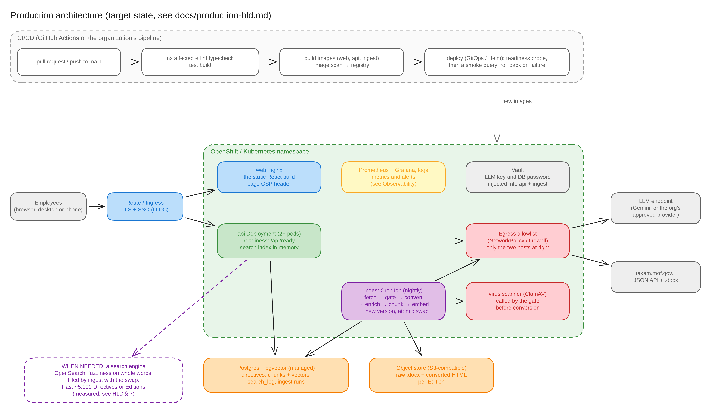

# Production high-level design

How the POC would run inside a government organization. Nothing here is built. The POC (README, Part B) is one Nx monorepo, with one SQLite file as its store, that runs on a laptop. This document describes what changes so it can serve every employee, every night, with no one running it by hand.

Source: [`diagrams/production-architecture.excalidraw`](diagrams/production-architecture.excalidraw). The dashed search engine is not part of the first production version: section 7 says when it is needed. The flows stay as they are in the POC:
- [the ingest pipeline](diagrams/ingest-pipeline.png)
- [a search request, library by library](diagrams/search-flow.png)
- [a chat request, library by library](diagrams/chat-request-flow.png)
- [the chat as a LangGraph](diagrams/chat-flow.png)

## 1. Runtime

The organization's container platform (OpenShift or another Kubernetes) runs three images, one per app. All three are built from the same repo.

| Part | Runs as | What changes from the POC |
|---|---|---|
| `apps/web` | a Deployment of nginx serving the static Vite build | nginx sets the page's own Content-Security-Policy (`default-src 'self'`, no inline scripts). In the POC, the Vite dev server serves the page and sets no CSP. |
| `apps/api` | a Deployment with 2 or more pods behind a Service | It reads Postgres instead of SQLite. A readiness probe on `/api/health` keeps a pod out of the Service until its search index is built. |
| `apps/ingest` | a CronJob, nightly (for example 02:00), `concurrencyPolicy: Forbid` | It writes to Postgres and the object store instead of `data/takam.db`. It runs with no one watching, so it reports through metrics and alerts instead of printing to a terminal. |

**Postgres + pgvector** (the organization's managed Postgres) replaces SQLite (ADR 0003 names it as the production store). The tables are the same: `directives` (metadata, enrichment, HTML), `chunks` (text and embedding, now a `vector(768)` column with an HNSW index), `search_log`, plus an `ingest_runs` table (start, end, counts, and whether the run was swapped in). The API still keeps MiniSearch in memory for the Directive search. For all of Takam it builds in about 0.1 s and takes about 16 MB per pod (measured; see section 7). The chat's vector search moves into Postgres (`ORDER BY embedding <=> $1 LIMIT 5`). In memory it would still take only about 15 ms for 7,000 chunks, but in Postgres every pod shares one copy, and the index is updated when the swap happens.

**The atomic swap stays, in a form that suits Postgres.** The POC writes `takam.db.tmp` and renames it. In production, each run writes into a new schema (`ingest_20261124`). When the run passes the 20% rules, one transaction points the `current` view (or a one-row `active_run` table the API reads) at the new schema. The API's pods pick it up on their next index rebuild (a background refresh every few minutes, or a rolling restart that the CronJob triggers). A failed run never touches what the API reads. Old schemas are dropped after 7 days, so a rollback to last night is one `UPDATE`.

**An object store** (S3-compatible: OpenShift Data Foundation, MinIO or a cloud bucket) holds the raw `.docx` of every Edition and its converted HTML, keyed `{code}/{edition}/`. That replaces the gitignored `data/raw/`. It keeps the evidence behind every stored Directive, and incremental ingest can skip an Edition it already has (see "Scale").

## 2. Security

- **Sign-in:** SSO in front of both the web app and the API, through the organization's identity provider (OIDC at the Route/Ingress, or an oauth2-proxy sidecar). The Directives are public, but chat costs money per question, and the search log should be tied to real users.
- **Secrets from a vault:** the LLM key and the database password come from Vault (or the organization's secret manager) into the pods as environment variables, through the External Secrets Operator or the Vault agent. Nothing secret is in the repo or the image. The POC already reads everything from the environment (`.env` is only for a laptop, and `.env.example` holds no values).
- **A virus scan in the gate:** the gate gets one more check, after the zip checks and before Mammoth opens the file: send the file to a ClamAV service (`clamd`) and reject it if it finds anything. That reject counts toward the 20% rule like any other. The POC has no scan (README, Part C, "What I chose not to build").
- **Network egress limited:** a NetworkPolicy, plus the organization's egress firewall or proxy, lets the pods reach only two outside hosts: `takam.mof.gov.il` (ingest) and the LLM endpoint (ingest and API). Everything else is refused, so a converted file that somehow ran code could not send data out.
- **What the POC already does, and production keeps** (ADR 0006): the gate's limits (2 MB, the `PK` magic bytes, `word/document.xml`, under 200 entries, under 20 MB expanded, counted as a stream), sanitize-html with an allowlist in ingest and again in the API, the API's strict CSP header, and citations checked in our code rather than by the model.
- **Images:** containers run as non-root with a read-only root filesystem, and the registry scans each image before deploy.

## 3. CI/CD

The repo's GitHub Actions workflow (`.github/workflows/ci.yml`) already runs format, lint, typecheck, test and build on every pull request. In production:

1. **On every pull request:** `npx nx affected -t lint typecheck test build`. Nx builds and tests only the projects a change touches, plus everything that depends on them. A change to `libs/search` re-tests the API and the web app, while a change to a README re-tests nothing. The full run stays on `main`.
2. **On a merge to `main`:** build one image per app that changed (`nx affected` decides which), tag it with the commit SHA, scan it, and push it to the organization's registry.
3. **Deploy** through GitOps (Argo CD or OpenShift GitOps): the pipeline updates the image tags in a deploy repo (Helm values or Kustomize), and Argo CD syncs the cluster. Staging first, then production, with an approval between them.
4. **After each deploy, the checks in section 4.** If they fail, the deploy is rolled back.

Migrations (the Postgres schema) run as a Job before the API's new pods start, and every migration must keep the previous API version working, so a rollback never needs a down-migration.

## 4. How to verify a deployment

The deploy counts as done only when all three pass. The pipeline runs them, and a person can run them by hand with the same commands.

1. **Readiness probe:** each API pod is Ready only when its readiness endpoint answers 200. The rollout waits for all new pods to be Ready and stops (keeping the old pods) if they don't get there in time. In the POC, `GET /api/health` returns `{directives, indexSize, lastIngest}` and always answers 200, even for an empty store. Production adds `GET /api/ready`, which answers 503 unless `directives > 0` and `indexSize == directives`, so a pod that started against an empty or half-built store never gets traffic. `/api/health` stays as it is, for people and dashboards.
2. **Smoke query:** the pipeline calls the live URL:
   - `GET /api/search?q=13.10.1` must return `H.13.10.1` first. That checks the database, the index and the Hebrew-aware tokenizer in one call.
   - `GET /api/directives/H.13.10.1` must return HTML and the CSP header.
   - `POST /api/chat` with a fixed question ("מה התעריף לקצובת הבראה?") must return `found: true` with at least one Citation. That checks the LLM key and the egress rule. It costs one LLM call per deploy.
3. **Freshness:** `lastIngest` in `/api/health` must be under 36 hours old. A deploy that works but serves a stale store is not a success.

## 5. Observability and alerts

The API and ingest export Prometheus metrics, and logs go to the cluster's log stack (Loki or EFK) as JSON, with a request id. Dashboards are in Grafana. The alerts that matter:

| Signal | Metric | Alert when | What it usually means |
|---|---|---|---|
| Ingest rejection rate | `ingest_files_total{result="rejected"} / ingest_files_total` per run, with the reason as a label | over 5% (warning), over 20% (the run fails; page) | the site changed: a new firewall rule, a new file format, a moved endpoint |
| Ingest did not swap | `ingest_last_success_timestamp` | older than 36 hours | the CronJob failed or did not run |
| Enrichment failures | `ingest_enrichment_failed_total` per run | over 5% | the LLM is rate-limiting, its key ran out, or a reply broke the schema |
| 0-result search rate | `search_requests_total{results="0"} / search_requests_total` (the `search_log` table holds the queries) | doubles week on week | words people use that the index misses; review the queries and add them to the tests |
| Chat errors | `chat_requests_total{status="503"}`, `{found="false"}` | 503s over 2% for 10 minutes | the LLM endpoint is down or blocked |
| Bad citations | `chat_citation_retries_total` | rising | a model change made answers cite wrong passages |
| LLM latency | `llm_request_duration_seconds` (chat, embedding, enrichment), p95 | chat p95 over 15 s | the provider is slow; the POC's chat takes about 6 s |
| LLM cost | input and output tokens per call, times the price | the daily budget passes 80% | heavy use, or a loop; see "Scale" |

## 6. The failure scenario, and how to roll back

**The scenario.** The Takam site sits behind a web firewall (Sucuri). When the firewall decides a client is a bot, it answers every download with an HTML challenge page and status 200, not with the Word file. The POC met this while it was being built: Node's default User-Agent got 403s, and a download URL with an empty last segment got the HTML page.

**What happens in this design:**
1. Ingest downloads 30 (or, in production, about 550) "files" that are all the same HTML page.
2. The gate rejects each one with the reason "an HTML page, not a Word file", because its first bytes are `<!DOCTYPE` and not the zip magic bytes `PK`. The gate gives the HTML page its own reason, apart from any other file that is not a zip.
3. 100% of the files are rejected, more than 20%, so ingest drops its new schema (in the POC, it deletes `takam.db.tmp`) and exits with code 1. **The old store stays live**, so employees still search and read yesterday's Directives, with no gap.
4. **An alert fires** in two ways: the rejection-rate alert (with the same `reason="html_page"` label on every file), and the CronJob's failed-Job alert. The next morning, the 36-hour freshness alert fires too if nothing is done.

**How to diagnose it:** the ingest logs list one reason per code (`✗ H.13.10.1: rejected by the gate: an HTML page, not a Word file`). When every rejection has the same reason, the cause is upstream, not in one file. Running one download by hand from a debug pod (`curl -A takam-poc-ingest/0.1 …/DownloadDocument/{id}/{code}`) shows the challenge page. Then fix the cause: ask the site's team to allow the egress IP, or change the User-Agent or the request rate, and re-run the Job (`oc create job --from=cronjob/ingest ingest-manual`).

**How to roll back:**
- **Bad data** (a run passed the 20% rules but the content is wrong, for example enrichment in the wrong language): point `active_run` back at the previous schema, in one `UPDATE`, and the API's next refresh serves it. Schemas are kept for 7 days.
- **A bad deploy:** revert the image tag in the deploy repo, and Argo CD rolls the Deployment back (or run `oc rollout undo deployment/api`). Migrations are backward-compatible, so the old API runs on the new schema.
- **A bad model** (the LLM provider changed the model behind a name): pin the model version in the config (`LLM_MODEL`, `EMBEDDING_MODEL`) in Vault, and restart. The embedding model must match the stored vectors, so a change of embedding model needs a full re-embed (one ingest run). The POC only fails a question whose vector length differs from the stored ones (the cosine function throws). Production should check the model name and vector length at startup and refuse to start on a mismatch.

## 7. Scale

- **All chapters.** The POC ingests 30 Directives from chapters 1 and 13. The site has about 550 Directives (and 1,127 Documents). That is still small: about 7,000 chunks, a few hundred MB with the HTML and vectors, and a MiniSearch index that builds in seconds. Postgres and pgvector handle that without tuning. The change is in ingest: walk the site's Chapter tree (`api/Document`) instead of a fixed list in `ingest.config.json`.
- **Incremental ingest keyed by Edition.** Most nights nothing changes. Ingest first reads the list of Documents and their highest Edition number, compares it with what the store holds, and downloads, converts, enriches and embeds only the Directives with a new Edition. Unchanged Directives are copied into the new schema as they are. That cuts a nightly run from 550 LLM calls to a handful, and it keeps yesterday's enrichment stable (the POC's full re-runs rewrote it, README "Hybrid retrieval"). A weekly full run catches anything the Edition number misses. Validity needs no re-ingest at all, because In force is computed from the dates on each request (ADR 0001).
- **LLM cost limits:**
  - enrichment: one call per new Edition, with the text cut to 20,000 characters (as in the POC)
  - embeddings: only for new Editions, in batches
  - chat: SSO identifies the user, so a per-user rate limit (for example 30 questions an hour) and a daily token budget for the whole service apply. Past the budget, `/api/chat` answers 503 with a clear message, and search keeps working, as it does in the POC when there is no key.
  - a cache of answers to the same normalized question for one ingest run, so the 20 people who ask about the per-diem rate on the same day cost one call
- **Does fuzzy search need a database or a search engine?** (ADR 0004) Not at Takam's size, but it will past about 5,000 Directives. The numbers come from `npm run bench:search` ([`scripts/search-scale.ts`](../scripts/search-scale.ts)). The script copies the 30 stored Directives up to each size and gives every copy 40 words of its own, so the number of distinct words grows with the number of Directives, as it would with real text. Fuzzy matching costs more as the number of distinct words grows. Each search is the average of 6 queries (a typo, a variant spelling, a code, a phrase), run on a laptop (Apple Silicon, Node 26):

  | Directives in the index | What that would be | Build (each pod, at startup or after a swap) | Memory per pod | One search |
  |---|---|---|---|---|
  | 30 | the POC | 8 ms | 2 MB | 0.4 ms |
  | 550 | all of Takam's Directives | 0.1 s | 16 MB | 5 ms |
  | 5,000 | every Edition, or every Document with its attachments | 1.1 s | 125 MB | 45 ms |
  | 50,000 | many sites like Takam | 14 s | about 1 GB | 480 ms |

  The chat's passage search grows the same way: 3 ms for the POC's 376 chunks, 15 ms for 7,000, and 220 ms for 50,000.
  - **Up to a few thousand Directives (all of Takam): no search engine.** MiniSearch in each API pod is the simplest thing that is fast enough. The index is rebuilt from Postgres after each swap, and our Hebrew rules (`normalizeWord`, `typosAllowed`) stay as they are and as they are tested.
  - **Past about 5,000 Directives, or when a search must be under 50 ms:** add a search engine. Every pod would otherwise hold and rebuild its own large copy, and the time grows with the size. This is the dashed box in the production diagram: **OpenSearch** (or Elasticsearch, whichever the organization runs). It is an index on disk, shared by all pods. Its `fuzziness` is the same edit distance on whole words as our `typosAllowed`: `fuzziness: "AUTO:4,8"` allows no typo up to 3 letters, one from 4, and two from 8, which is our rule exactly. (A word with a digit still has to match exactly; the API sends it with `fuzziness: 0`.) Field weights become `boost`, In force becomes a date-range filter, and ingest writes a new index and moves an alias to it, which is the same atomic swap.
  - **Hebrew stays in our code.** OpenSearch has no analyzer that applies our rules (prefix letters, ו/י, quotes, final letters). So ingest indexes the words as `normalizeWord` returns them, with a plain whitespace analyzer, and the API normalizes the query the same way. One function, already tested, decides what matches.
  - **Why not fuzzy search in Postgres:** Postgres full-text search has no Hebrew dictionary. `pg_trgm` measures how many three-letter pieces two words share, not how many letters differ. A 3–4 letter Hebrew word has only a few such pieces, so `pg_trgm` either misses a one-letter typo or matches an unrelated short word (`רכב` car, `רכז` coordinator). Postgres stays the store; it is not the fuzzy search.
- **More users:** the API is stateless apart from its in-memory index, so it scales by adding pods (a HorizontalPodAutoscaler on CPU). Search is in memory and fast. Chat time is the LLM's, so it scales with the provider's quota, not with our pods.
